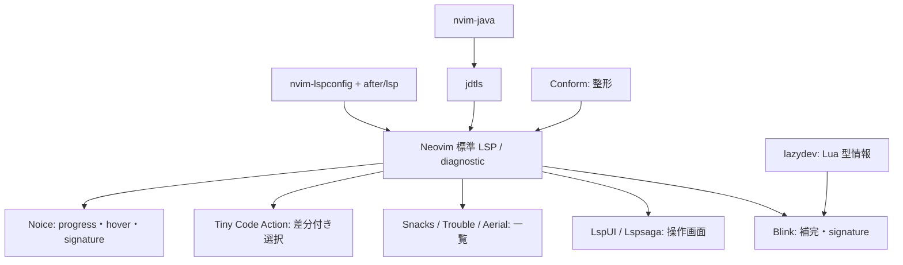

# プラグインの設定重複と LSP 整理

調査日: 2026-09-08。[全体の棚卸し](PLUGIN_INVENTORY.md)を、個別設定と呼び出し元で再確認したもの。
以下は設定・ソースの静的解析であり、日常の使用頻度や画面上での同時表示を測定した結果ではない。
プラグインの削除・設定変更はまだ行っていない。

74個別設定と直接登録・依存をプラグイン単位で確認した
[全プラグインの設定用途](PLUGIN_USAGE.md)も参照。

## 主な結論

- LSP の操作 UI は **Lspsaga・LspUI・Snacks・Tiny Code Action** に分散。
  特に Lspsaga の `K/gd/gr` は LspAttach 時のバッファローカル設定に隠れる。
  Lspsaga にしか割り当てていない診断・outline・Visual の code action もあり、丸ごと未使用ではない。
- **Blink と Noice の signature help は両方有効**。Noice の設定省略部分にもデフォルトの自動表示がある。
  LspUI の signature は明示的に無効なので、こちらは重複に数えない。
- **ファイラ、端末起動、囲み編集、折り畳み**は、同じ目的の操作を複数登録している。
  一方、Noice と Notify、LSP と Blink、Neotest とテスト adapter は連携関係であり、同一機能の二重実装として数えない。
- Trouble と Lspsaga の一部キーは、lockfile の版に存在しないコマンドを呼ぶ。
  「設定されている」だけでなく「その入口が有効か」も整理が必要。

## 判定の読み方

| 判定 | 意味 |
| --- | --- |
| 操作が重複 | 同じ目的のコマンド・キーを複数の実装に割り当てている。両方が同時に動くとは限らない |
| 自動処理が重複 | 同じ種類の自動表示・オプション設定などを複数箇所で有効化している |
| 一方が隠れる | バッファローカル設定がグローバル設定に優先するなど、入口が実質的に上書きされる |
| 補完関係 | 同じ分野だが機能・対象・表示場所が違う |
| 登録のみ／入口未確認 | 個別設定や起動経路がなく、実用上の利用を断定できない |

グローバル同士の同一キーは、lazy.nvim の登録・ロード順に影響されるため、この調査では勝者を断定しない。
バッファローカルとグローバルが重なる場合は、前者が優先する。
キーのモード・バッファが違うだけなら衝突とは扱わない。

## LSP 以外も含めた、実際の設定重複

| 機能 | 設定で確認した内容 | 判定・整理の単位 |
| --- | --- | --- |
| ファイラ起動 | [Fern](lua/plugins/fern.lua) と [Snacks](lua/plugins/snacks.lua) が normal の `<leader>e`。Fern は `<leader>E/ce` も持つ。[Yazi](lua/plugins/yazi.lua) は `<leader>y`。[Fyler](lua/plugins/fyler.lua) は `opts = {}` のみ | Fern / Snacks はキーも重複。Yazi は別入口。Fyler は独自入口なしで、使っているとは断定できない |
| ファイルを分割・タブで開く | Fern と Yazi は `<C-v>/<C-l>/<C-t>`。Snacks picker は `<C-v>/<C-h>/<C-t>` | 操作は重複するが専用画面内のキーなので衝突ではない。Fern は削除・作成・rename・プレビューも個別設定済み |
| 囲みの追加・削除・変更 | [lazy.lua](lua/config/lazy.lua) で Surround / Sandwich を両方登録し、デフォルトキーを無効にしていない。Surround は `ys/ds/cs`、Sandwich は `sa/sd/sr` | 同じ編集目的を別キーで二重提供。Surround の Visual `S/gS`、Sandwich の `ib/ab/is/as` 等の利用も比較して片方を選ぶ |
| 端末起動・表示切り替え | [Termite](lua/plugins/termite.lua) の `<C-/>` / `<C-t>`、Snacks の `<leader>u`、[init.lua](init.lua) の `:T/:Th` | 起動経路が3系統。Termite は next/prev/maximize も設定済み。Snacks の terminal 設定ブロックはコメントでも、`Snacks.terminal.toggle()` 呼び出しは有効 |
| 端末の挿入モード移行 | Termite の `start_insert = true`、[Bufterm](lua/plugins/bufterm.lua) の `start_in_insert = true` と `save_native_terms = true`、`:T/:Th` 内の `startinsert` | 自動処理の意図が重複。Bufterm は標準端末も管理するので、起動キーがないことを理由に未使用とは判断できない |
| 端末内の編集・外部エディタ接続 | [Term-edit](lua/plugins/term-edit.lua) はプロンプト編集、Guise は既存 Neovim への接続 | 端末管理とは補完関係。未 import の waitevent は現在の二重処理に含めない |
| 折り畳みの式と操作 | [Tree-sitter](lua/plugins/treesitter.lua) が FileType で `foldmethod/expr` を設定。[UFO](lua/plugins/ufo.lua) も init で同じオプションを設定し、provider は `treesitter, indent`、`zR/zM/zr/zm` を上書き | 設定の競合＋操作拡張。UFO はこの設定では LSP provider を使わない。UFO の折り畳み操作を不要とするなら標準 fold に寄せられる |
| ファイル再表示時の位置復元 | [Lastplace](lua/plugins/nvim-lastplace.lua) と init.lua の `BufWinEnter → loadview` / `BufWinLeave → mkview` | 復元処理が重なる。Lastplace は ignore 対象と `lastplace_open_folds = true`、view は位置以外の表示状態も扱うため、同等とは断定しない |
| Git の状態・履歴・差分 | [Gin](lua/plugins/gin.lua) の status/log/patch、[fm-nvim](lua/plugins/fm-nvim.lua) の Gitui/Lazygit 起動、[Gitgraph](lua/plugins/gitgraph.lua) のグラフ、[Diffview](lua/plugins/diffview.lua) の差分 | Git 操作の入口は重複。Gitgraph → Diffview は連携。Gin は専用プレビューもあり、ファイル1枚を消すだけでは参照が残る |
| 行 blame | [Gitsigns](lua/plugins/gitsigns.lua) の `current_line_blame = true`、Snacks の `<leader>B → Snacks.git.blame_line()` | 同じ情報の自動表示と手動表示。Snacks の desc は「Git Branches」だが実装は blame。ブランチ一覧として数えない |
| quickfix の閲覧 | [Quicker](lua/plugins/quicker.lua) の `<leader>q`、Snacks の `<leader>sq`、[Trouble](lua/plugins/trouble.lua) の `<leader>xq`、bqf の登録 | 閲覧用途は重複。Quicker の編集・前後2行の展開と bqf のプレビューは補完関係。Trouble の入口は後述の不整合あり |
| TODO 検索 | [todo-comments](lua/plugins/todo-comments.lua) の `<leader>st → Snacks.picker.todo_comments()`、Trouble の `<leader>xt` | 検索結果の入口が重複。todo-comments の強調と Snacks の検索 UI は連携なので、片方だけで同じ体験にはならない |
| コード・テスト実行 | [QuickRun](lua/plugins/vim-quickrun.lua) の `:qr`、[Overseer](lua/plugins/overseer.lua) の `<leader>r/R`、[Neotest](lua/plugins/neotest.lua) の `<leader>tn/tf/ta/ts/to`、[mini.test](lua/plugins/mini-test.lua) の setup | 同じテストを二重起動する設定はない。Neotest は Vitest（coverage 指定）・Plenary、mini.test は別テストフレームワーク。Overseer に同一テスト用の独自タスク定義はない |
| AI CLI・選択送信 | [Aibo](lua/plugins/aibo.lua) は opencode 起動と選択送信、[Sidekick](lua/plugins/sidekick.lua) は CLI 選択・文脈送信。両方に normal の `<leader>at` | 同じキーで Aibo 起動と Sidekick 送信が重複。`<leader>av` は Aibo が normal、Sidekick が Visual なので同一モード衝突ではない |
| AI とアウトラインのキー | Sidekick の `<leader>aa` は CLI toggle、[Aerial](lua/plugins/aerial.lua) の同じキーは outline | AI 条件有効時に異なる機能が衝突。これは機能重複ではなくキーの問題 |
| 通知 | [Noice](lua/plugins/noice.lua) は `messages.view = 'notify'`、[Notify](lua/plugins/nvim-notify.lua) は `vim.notify` を差し替え | 主にフロントエンドと通知描画の連携。二つあるだけで通知が二重発火すると判断しない。Snacks notifier は個別に有効化していない |
| 診断の件数表示 | [Bufferline](lua/plugins/bufferline.lua) の `diagnostics = 'nvim_lsp'`、[Lualine](lua/plugins/lualine.lua) の winbar `diagnostics` | 同じ診断データをタブラインと winbar に表示。両プラグイン全体の役割は異なる |
| テーマ | [colorscheme.lua](lua/plugins/colorscheme.lua) は `edge` を適用。neko-night は登録のみ | 同時適用の重複ではなく、選択肢として残している追加テーマ |
| 入力補完 | Blink が有効、ddc は未 import、pum だけ直接登録が残る | Blink / ddc の同時稼働設定ではない。pum は現在の設定から利用経路を確認できない |
| 括弧・タグ補完 | [Blink](lua/plugins/blink.lua) の補完確定時 `auto_brackets`、[Lexima](lua/plugins/lexima.lua) の入力補助、[Autotag](lua/plugins/nvim-ts-autotag.lua) のタグ処理 | 括弧・タグという対象は近いがトリガーが異なる。設定だけで同じ入力を二重処理すると断定しない |

Aibo の `opts.keys` は通常の lazy spec の `keys` と異なり、テーブル評価中に `vim.keymap.set()` を実行している。
このため、環境変数で実行条件を満たさなくても import 時のキー定義が走る点には注意が必要。
Sidekick / Aerial との整理時はキー定義の置き場所も確認する。

## LSP の構成と、削減対象を分ける考え方

LSP サーバー、補完、UI は同じ機能ではない。現在は次の接続になっている。

図は機能・データの関係。lazy.nvim の依存宣言とは異なる。

| 層 | 対象 | この設定での責務と削減判断 |
| --- | --- | --- |
| サーバー設定 | nvim-lspconfig、after/lsp | `vim.lsp.config/enable` にサーバー定義・追加設定を与える。UI 削減のためにここを消す必要はない。単純削除すると各言語の設定供給と現在の有効化処理を失う |
| Java 統合 | nvim-java | jdtls 有効化、Lombok、Spring Boot、Java test。汎用 UI とは別枠 |
| 補完 | Blink、blink-cmp-skkeleton | LSP 補完に加え、SKK・パス・バッファ・コマンドラインを担当。LspUI/Lspsaga の代わりに削る対象ではない |
| Lua 開発 | lazydev | `lua_ls` の library 管理と Blink の `lazydev` ソース。削除時は Blink 側の provider/default sources も変更する |
| 汎用操作 UI | LspUI、Lspsaga | hover・rename・定義・参照・診断など、最も集約しやすい層 |
| code action | Tiny Code Action | difftastic による変更内容のプレビューが独自価値。単純な選択でよいなら標準 API に集約できる |
| 検索・一覧 | Snacks、Trouble、Aerial | 一時的な picker、診断一覧、常設アウトラインの違い。Snacks は LSP 以外にも多数参照される |
| 表示 | Noice、tiny-inline-diagnostic、Bufferline、Lualine | progress、行内診断、件数等。Noice は LSP 関連の一部機能だけ無効にする選択もある |
| 整形 | Conform | 外部 formatter の選択・保存時処理。Java と手動処理には LSP fallback。汎用 LSP UI の重複とは別 |
| 構文解析 | Tree-sitter、UFO、Autotag | LSP サーバーとは別の構文処理。Aerial のデータ源にもなる |

### LSP 機能ごとの重複と実効入口

以下の「接続後」は lspconfig の LspAttach callback が正常に動き、LspUI を require できる場合。

| 機能 | 設定されている提供元・入口 | 判定 |
| --- | --- | --- |
| Hover | Lspsaga `K`、LspUI `hover.enable = true` と接続後の `K`。Noice は標準 hover を置き換える設定がデフォルト有効 | 接続後の `K` は LspUI。Lspsaga のキーは隠れる。Noice が LspUI 独自画面まで同時表示するとは限らない |
| 定義 | Lspsaga `gd → peek_definition`、Snacks `gd → lsp_definitions()`、接続後 `gd → vim.lsp.buf.definition` | 標準の定義ジャンプが優先。peek と picker は別の体験だが同じキーでは使い分けられない |
| 宣言・分割定義 | Snacks `gD → lsp_declarations()`、接続後 `gD → vsplit + definition()` | 宣言の入口が分割定義に変わる。意味まで異なる上書き |
| 参照 | Snacks `gr`、LspUI `gf → finder ref`、Lspsaga `gh → lsp_finder`、Trouble `gR` | 接続後 `gr` は参照ではなく rename。`gh/gR` はコマンド不整合もあるため後述 |
| 実装 | 接続後 LspUI `gl`、Snacks `gI`、Lspsaga finder の `default = 'ref+imp'` | LspUI と Snacks に別キーの有効な設定。finder は入口修正が必要 |
| 型定義 | 接続後 LspUI `gt`、Snacks `gy` | 別キーで操作が重複 |
| Rename | Lspsaga `gr`、接続後 LspUI `gr` | LspUI 優先。LspUI がない場合は `<F2>` に標準 rename、`gr` に標準 references となり、単純削除でキーの意味が変わる |
| Code action | Lspsaga normal/Visual `ga`、Tiny Code Action normal `ga`、LspUI `code_action.enable = true` | normal は同一キー競合。Visual は Lspsaga に設定。LspUI はコマンド機能有効だが専用グローバルキーなし。3つを同時に実行する設定ではない |
| Git の code action | Lspsaga `extend_gitsigns = true`、LspUI `gitsigns = true` | 同じ Gitsigns 連携の意図を両方に設定。Tiny Code Action / 標準 API に移す際は Git hunk 操作を同等と仮定しない |
| Code action の電球 | LspUI `lightbulb.enable = true`、Lspsaga `lightbulb.enable = false` | 二重表示の設定ではない。LspUI を削るとこの電球機能を失う |
| Signature help | Blink `signature.enabled = true`、`<C-s>` で表示切り替え。Noice のデフォルトは signature と auto_open が有効。LspUI は `signature.enable = false` | Blink / Noice の自動処理が重複。引数ヒントを Blink に集約するなら Noice の `lsp.signature.enabled = false` を明示する |
| 補完候補の説明 | Blink `completion.documentation.auto_show = true`、delay 1000ms | signature/hover と情報は近いが、選択候補の説明という別トリガー。Noice で有効化している override は標準 Markdown utility で、Blink 専用説明 UI の重複設定はない |
| 診断の移動 | Lspsaga `[e/]e`、接続後 LspUI `g[/g]` | 同じ目的を2系統のキーで提供。`g[/g]` は LspUI の存在確認なしで定義しており、削除後に壊れる |
| その場の診断 | 標準 `ge → vim.diagnostic.open_float`、Lspsaga `<leader>sl → show_line_diagnostics` | 操作が重複。`<leader>sl` は Snacks の loclist とキーまで衝突 |
| バッファ診断 | 接続後 Lspsaga `gb`、Lspsaga `<leader>sb`、Snacks `<leader>sD`、Trouble `<leader>xd` | 一覧の入口が複数。`<leader>sb` は Snacks の行検索とも衝突。Trouble はコマンド不整合あり |
| 全体の診断 | 接続後 Lspsaga `gw`、Snacks `<leader>sd`、Trouble `<leader>xw`、標準 `gq → setqflist` | 目的は近いが、float/picker/quickfix という違い。Lspsaga 削除時には `gb/gw` の代替設定が必要 |
| 診断の常時表示 | 標準 signs/underline は有効、`virtual_text = false`。tiny-inline-diagnostic は spec 登録だけ。Bufferline / Lualine は診断件数表示 | tiny-inline は setup 未指定なので、現在の行内表示の担当とみなさない。sign・下線・件数は表示場所が異なる |
| Outline / symbols | Aerial `<leader>aa`、Lspsaga `<leader>so`、Snacks `<leader>ss/sS` | 操作が重複。Aerial は `treesitter → lsp → markdown…` の backend 順、`open_automatic = false`。常に3画面が開く設定ではない |
| パンくず | Lspsaga `symbol_in_winbar.enable = false`、Lualine が `lspsaga.symbol.winbar.get_bar()` を呼ぶ | Lspsaga 自身の winbar は無効だが、Lualine からの参照は残る。シンボルデータがない場合は表示を返さず、現在の見た目が有効とは断定しない |
| 呼び出し階層 | LspUI `call_hierarchy.enable = true`、Lspsaga `callhierarchy` の画面設定 | 機能設定は両方にあるが、この設定に専用のグローバルキーはない。コマンドで利用しているかが判断点 |
| 型階層 | Lspsaga `typehierarchy` の画面設定 | 他に同じ階層表示の明示設定はない。型定義ジャンプとは別機能 |
| Inlay hints | lspconfig が対応サーバー接続時に `vim.lsp.inlay_hint.enable(true)`。各言語設定で hint 内容を指定 | 実際の自動有効化は標準 API。LspUI の cmd に InlayHint 名があるだけで二重有効化とは数えない |
| LSP progress | Noice `lsp.progress.enabled = true`、特定メッセージを route で除外 | 明示された担当は Noice。Lualine の `progress` はファイル内位置の割合であり、LSP progress ではない |

### 整形・言語サーバーの重複をどう見るか

[Conform](lua/plugins/conform.lua) の既定は `lsp_format = 'never'`。
保存時に外部 formatter と LSP formatter を必ず二重実行する設定ではない。
Java は filetype 設定で `lsp_format = 'fallback'`、手動 `<leader>cf` は
`lsp_fallback = true` を指定する。lockfile の Conform には後者を `lsp_format = 'fallback'` に変換する互換処理がある。
`:w!` では format_on_save が nil を返す。

| 対象 | 設定と判断 |
| --- | --- |
| TypeScript / JavaScript | [vtsls](after/lsp/vtsls.lua) は `package.json`、[denols](after/lsp/denols.lua) は `deno.json/deno.jsonc/deps.ts` を root marker にする。両方 `workspace_required = true`。使い分けの意図はあるが、互いを明示除外していないため両 marker のある構成で同時接続を防ぐ保証はない |
| Svelte | [svelte](after/lsp/svelte.lua) と vtsls の TypeScript Svelte plugin 設定がある。同一サーバーの二重起動とは異なり、Svelte と TS 側の連携設定として扱う |
| ESLint / Actions | [eslint.lua](after/lsp/eslint.lua) と [actionsls.lua](after/lsp/actionsls.lua) はあるが、lspconfig の enable リストにない。別の有効化呼び出しも設定内にはないので、現在の二重 LSP として数えない。Conform の `eslint_d` は別の外部 CLI |
| スペル・typo | `typos_lsp` が診断を Hint として提供。Conform の Markdown は `typos` を保存時に実行。診断と修正で役割が異なるが、同じ指摘・修正方針を扱うため双方の必要性を確認 |
| Java | [nvim-java](lua/plugins/nvim-java.lua) が jdtls を有効化し、[after/lsp/jdtls.lua](after/lsp/jdtls.lua) が追加設定を提供。二重サーバー登録ではない。Java test は Neotest adapter にも含まれておらず、Neotest への置換済みではない |
| Lua | [lua_ls](after/lsp/lua_ls.lua) の library 手動設定を外して lazydev に委ねている。lazydev と lua_ls は補完関係 |
| Lint | nvim-lint は未 import。LSP 診断と nvim-lint を同時実行する現在の設定はない |

共通の enable リストは17件:
`svelte, vtsls, lua_ls, sqls, typos_lsp, bashls, fsautocomplete, csharp_ls, vimls, jsonls, yamlls, lemminx, tailwindcss, fish_lsp, gopls, denols, nixd`。
別途 nvim-java が `jdtls` を有効化する。これは起動済みプロセス数ではなく、対象ファイル・root・実行バイナリが揃えば起動する設定の数。
Copilot の enable と標準 inline completion のコードはコメントアウトされている。

### 登録されているが、入口・初期化に問題があるもの

lockfile の commit をローカルの Git オブジェクトから読み、設定と照合した。
最新版一般の話ではなく、ここで固定されている版についての指摘。

| 対象 | 設定と実装の食い違い | 整理への影響 |
| --- | --- | --- |
| Trouble の全キーマップ | `TroubleToggle …` を呼ぶが、固定版の実装は `:Trouble` を登録し、`TroubleToggle` の定義はない | 設定上の診断・参照 UI がそのまま動くとみなさない。残す場合は `Trouble diagnostics toggle` 等、モードも含めて作り直す |
| Lspsaga `gh` | 設定は `Lspsaga lsp_finder`、固定版の subcommand は `finder` | finder を使うなら入口修正が必要。現在使っていない理由が機能不要か入口不良かを区別する |
| LspUI `gf` | 設定は `LspUI finder ref`、固定版に finder 登録はなく、参照機能は `reference` | 参照操作を残すなら `LspUI reference` か Snacks picker 等への付け替えが必要 |
| LspUI の lazy cmd 一覧 | `LspUIRename` 等の独立した名前が多数あるが、実装の Ex コマンドは `LspUI`＋subcommand | lazy 読み込み用の名前列挙は機能有効化の証拠ではない。残す場合は不要な command stub も整理 |
| tiny-inline-diagnostic | `event = 'VeryLazy'` の登録だけで `opts/config/setup` がない。固定版の初期化は `setup()` 内 | この設定から自動の行内診断表示が有効になっているとはいえない。削除して失う表示があると前提を置かない |
| nvim-treesitter-context | 個別 setup がないが、プラグインの `plugin/treesitter-context.lua` が `setup()` を実行 | tiny-inline と違って自動初期化される。単なる未設定の残骸としては扱わない |

### 削減案：現在の設定から変更範囲を小さくする順

以下は実装前の案。使用頻度を推測して「不要」と断定するものではない。

**まず LspUI を残し、Lspsaga を外す案**は、接続後の `K/gr/gl/gt` がすでに LspUI である点で変更を小さくできる。
Snacks は検索 UI、Blink は補完と signature、Tiny Code Action は差分付き code action を担当させる。

| 作業 | 保持する操作／変わる点 |
| --- | --- |
| Lspsaga の import と lspconfig 内 dependencies を除去 | import だけ外すと再登録されるため両方必要 |
| lspconfig の `gb/gw` を Snacks の buffer/all diagnostics へ変更 | 日常のキーを維持しつつ、float から picker への見た目の変化を明確にする |
| `[e/]e` を LspUI または標準診断移動へ割り当て | 単に Lspsaga を消すとこの移動キーを失う |
| normal/Visual の `ga` の担当を1か所で定義 | normal は Tiny Code Action を継続する案。Visual は標準 `vim.lsp.buf.code_action` 等へ明示的に移す。差分表示・選択範囲の扱いは実装時に確認 |
| `<leader>so` を Aerial などへ移す | Outline を残せるが、Lspsaga から Aerial への画面・抽出方式の違いはある。Aerial の `<leader>aa` は Sidekick と重なるので再配置する。Markdown ftplugin の `AerialOpen` も参照元 |
| Lualine の Saga `get_bar()` 呼び出しを削除または差し替え | その場のパンくずが必要か確認。`pcall(require)` があるからといって死んだ参照を残さない |
| LspUI の `gf` を `reference` に修正 | 現在のコマンド不整合を解消して参照入口を確保 |
| Noice の signature を明示的に無効化 | Blink を引数ヒントの担当にする。Noice の cmdline/messages/progress は残せる |

この案で失う固有機能は、Lspsaga の peek 画面、独自診断画面、呼び出し／型階層画面、ジャンプ時 beacon 等。
これらをコマンドから使う場合は、単にキーの重複だけで削除を決めない。

**さらに LspUI も外して、標準 API＋Snacks に集約する案**では、次の対応が追加で必要。

| 現在の操作・参照 | 集約先の案と注意点 |
| --- | --- |
| `K` | `vim.lsp.buf.hover`。Noice を残すなら hover 表示は Noice が担当し得る |
| `gr` | `vim.lsp.buf.rename`。既存 fallback は `gr = references` なので、そのまま削除せず意味を固定する |
| `gf/gl/gt` | Snacks の references/implementations/type_definitions に割り当て。既存の `gI/gy` とキーを整理 |
| `gd/gD` | 現在の標準 definition/分割 definition を維持するか、Snacks に統一するかを選ぶ。宣言ジャンプの入口を別途確保 |
| `g[/g]` | 標準診断移動へ変更。この2キーは現在 LspUI 不在時の fallback がない |
| `lspconfig.dependencies` と LspUI の import | 両方除去し、`pcall(require, 'LspUI')` と分岐も整理 |
| 電球・呼び出し階層 | LspUI の電球表示がなくなる。階層表示が必要なら標準 API 等への入口を用意する |

**独立して判断できる追加候補**は次のとおり。

| 対象 | 残す理由 | 削る場合 |
| --- | --- | --- |
| Trouble | 診断・参照等を専用一覧で常設したい | Snacks / 標準 quickfix で足りるなら削減対象。現在の `<leader>x…` / `gR` / TodoTrouble の入口も整理する |
| Tiny Code Action | difftastic による適用前の差分を見たい | 差分が不要なら標準 code action と Snacks の選択 UI 等へ寄せる。`ga` の機能を先に確保する |
| Aerial | 階層アウトラインを常設したい、Tree-sitter/Markdown backend を使う | Snacks の symbols で足りるなら削減候補。ただし LSP のない Markdown 等で同じ情報を得られるとは限らない。Markdown ftplugin の `AerialOpen` も削除・移行対象 |
| tiny-inline-diagnostic | 独自の行内診断表示を明示的に使いたい | 現状は setup 経路がないため登録整理の候補。標準の `virtual_text = false` はそのままでも他の診断入口は残る |
| nvim-java | Java test / Lombok / Spring Boot 統合が必要 | 単純削除不可。jdtls の有効化・bundle 設定を代替し、[java ftplugin](after/ftplugin/java.lua) の `require('java').test…`（`gTM/gTC/gTV`）も変更。DAP/Spring 依存の要否は別途確認 |
| lazydev | Neovim Lua の型・補完情報を利用 | Blink の `lazydev` provider と default sources を除去し、lua_ls の library 情報をどうするか決める |

件数の目安として、Lspsaga・LspUI・Trouble・tiny-inline-diagnostic を外す案は直接登録を4件減らす。
さらに Tiny Code Action・Aerial も不要なら6件減らす。
いずれも役割の移し替えを伴う案であり、まだ削除していない。
web-devicons、Plenary、Snacks 等は他プラグインも利用するため、同じ数の依存が消えるわけではない。

## 根拠と確認範囲

- 個別設定の明示値、`keys`、`vim.keymap.set`、`opts/config/init`、dependencies を確認。
- [lazy.lua](lua/config/lazy.lua) の import、[lspconfig.lua](lua/plugins/lspconfig.lua) の LspAttach、
  [init.lua](init.lua)・after/lsp・after/ftplugin を横断して参照を確認。
- デフォルト値・コマンド名など設定だけで決まらない部分は、インストール済みリポジトリの Git オブジェクトから
  **[lazy-lock.json](lazy-lock.json) に記録された commit** を `git show` / `git grep` で確認。
  インストール済み HEAD と lock の commit が異なるものがあるため、両者を混同していない。

| プラグイン | 確認した commit（先頭12桁） | 主な実装ファイル |
| --- | --- | --- |
| Noice | `7bfd942445fb` | `lua/noice/config/init.lua`（hover/signature デフォルト）、`lua/noice/view/backend/notify.lua` |
| Lspsaga | `e6c04f88836d` | `lua/lspsaga/command.lua`、`lua/lspsaga/symbol/init.lua`、`lua/lspsaga/symbol/winbar.lua` |
| LspUI | `ac40e75a04b5` | `lua/LspUI/command.lua`、`lua/LspUI/reference/init.lua` 等の command 登録 |
| Trouble | `bd67efe408d4` | `lua/trouble/config/init.lua` と Lua ファイル内の command 定義検索 |
| Conform | `dca1a190aa85` | `lua/conform/init.lua`（lsp_fallback 互換処理） |
| nvim-treesitter-context | `b311b3081895` | `plugin/treesitter-context.lua`（自動 setup） |
| tiny-inline-diagnostic | `147af4e49f51` | `lua/tiny-inline-diagnostic/init.lua` と setup 呼び出し検索 |
| nvim-java | `602a5f7fa92f` | `lazy.lua`（DAP / Spring Boot / nui 依存） |
| Surround | `3d188ed21134` | `plugin/surround.vim`（デフォルトキー） |
| Sandwich | `74cf93d58ccc` | `plugin/sandwich.vim`（デフォルトキー） |

通常設定で Neovim を起動したり、LSP サーバー・AI CLI・テストを実行したりはしていない。
次に設定を変更する段階では、代表的な LSP バッファで `:verbose nmap K`、`:verbose nmap gr`、
`:verbose nmap ga`、`:verbose xmap ga` 等を確認し、hover・参照・rename・範囲 code action・診断移動・signature の動作を検証する。
